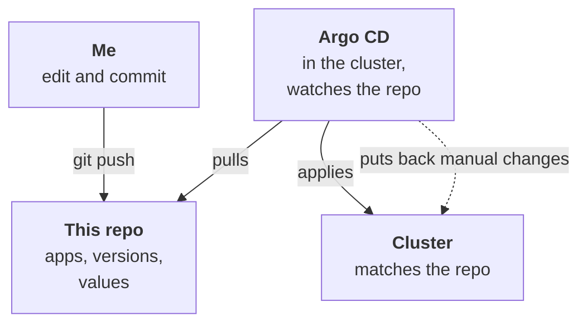

# k8s-gitops

k8s-gitops holds everything that runs on my Kubernetes clusters. Argo CD watches this repo and makes each cluster match it. The clusters themselves are built by [k8s-infra](https://github.com/edy-rus/k8s-infra), which stops at "the cluster is up and Argo CD is installed". Everything after that lives here.

The one idea to hold on to: **Git is the only way in.** To install, upgrade or remove something, change a file here and commit. Argo CD notices, applies it, and keeps putting it back if someone changes the cluster by hand.



Status: being built. What comes next is in [ROADMAP.md](ROADMAP.md).

## How It Fits Together

| Repo | Owns | Tool |
|---|---|---|
| [chibang](https://github.com/edy-rus/chibang) | The host: storage, backups, the VM platform | bootc image, GitHub Actions |
| [k8s-infra](https://github.com/edy-rus/k8s-infra) | The cluster: VMs, Talos, Kubernetes, Argo CD install | OpenTofu |
| **k8s-gitops** | What runs on the cluster | Argo CD |

## Layout

```
clusters/
  lab/                 one Argo CD Application per component, with its chart version
    argocd.yaml        Argo CD managing its own install
apps/
  <component>/         Helm values and extra manifests, shared by every cluster
    argocd/values.yaml
```

**App of apps:** k8s-infra creates one root application, called `root`, that points at `clusters/lab/`. Each file there is a child application for one component, such as Argo CD itself or the monitoring stack. Adding a component means adding one file there and its values under `apps/`.

## Bootstrap

The cluster is created by k8s-infra, and its last step installs Argo CD and the root application. So this repo must be on GitHub (public, so Argo CD needs no credentials) before that apply runs.

1. k8s-infra installs the `argo-cd` chart once, as release `argocd` in namespace `argocd`.
2. It creates the root application, which syncs `clusters/lab/`.
3. `clusters/lab/argocd.yaml` uses the same release name, so Argo CD adopts its own install. From here, Argo CD upgrades are a version change in that file.

Until private access is set up, reach the Argo CD UI with a port forward:

```sh
kubectl -n argocd port-forward svc/argocd-server 8080:80
kubectl -n argocd get secret argocd-initial-admin-secret -o jsonpath='{.data.password}' | base64 -d
```

Then open <http://localhost:8080> and log in as `admin`.
