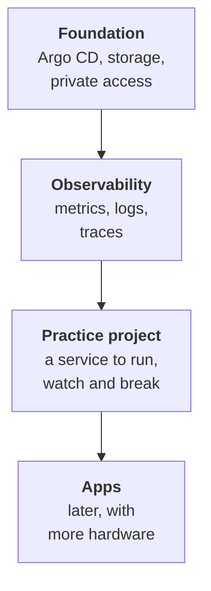

# Roadmap

The cluster from [k8s-infra](https://github.com/edy-rus/k8s-infra) is up but empty. This repo fills it, in three stages: the foundation that lets Argo CD manage everything, then observability, then apps once there is more hardware.

The one idea to hold on to: **nothing is installed by hand.** After the one bootstrap step, every change is a commit here, and Argo CD makes the cluster match.

## Constraints

These shape every choice below:

- **One small node.** The lab is a single Talos VM on chibang, which has 4 cores and 32 GB of RAM in total. Everything must fit next to the storage host's own work.
- **The network is about to change.** A house move, then a month or two of travel, possibly with chibang replicated to a site in the US. Nothing should depend on a LAN address range.
- **Storage stays on chibang.** The cluster only keeps data it can lose, such as metrics and logs with short retention. Apps that need real data wait.

## Foundation

- [ ] **Bigger lab VM.** Raise `talos-cp1` from 2 vCPU and 6 GB to 4 vCPU and 12 GB in k8s-infra, so the observability stack fits.
- [ ] **Argo CD bootstrap** as the last OpenTofu step in k8s-infra: install Argo CD with Helm and create the root application pointing at `clusters/lab/` in this repo. From then on Argo CD also manages its own upgrades.
- [ ] **App of apps.** One root application, one child application per component, each with pinned chart versions and its values in Git.
- [ ] **Storage for throwaway data.** A local-path provisioner on the Talos VM disk, for Prometheus and Loki. Losing it means losing recent metrics and logs, nothing more.
- [ ] **Private access over Tailscale.** The Tailscale Kubernetes operator gives each UI (Argo CD, Grafana) its own tailnet name with HTTPS. It works the same at home, in the new house and abroad, with no LAN IPs, no load balancer and nothing exposed to the internet.
- [ ] **Secrets.** Decide how secrets get into Git safely (Sealed Secrets or SOPS) before the first one is needed, starting with the Tailscale OAuth client.

## Observability

- [ ] **Metrics:** kube-prometheus-stack (Prometheus, Alertmanager, Grafana, node and cluster dashboards). Short retention and modest resource limits.
- [ ] **Logs:** Loki in single-binary mode, with Grafana Alloy collecting pod logs.
- [ ] **Traces:** an OpenTelemetry Collector, plus Tempo to store traces, all viewed in Grafana.
- [ ] **Alerts that reach me:** Alertmanager to a phone notification for a short list of real problems (node down, disk filling, Argo CD out of sync).
- [ ] **Dashboards as code:** Grafana dashboards stored in this repo, not built by clicking.

## Then

- [ ] **The practice project** deploys here and uses the observability stack for its traces, metrics and load tests.
- [ ] **Write-up** for the portfolio once the foundation and observability work.

## Apps (Later)

Waiting on more hardware and a storage decision. The wish list, from earlier planning: Immich (first, to leave Google Photos), Jellyfin, Navidrome, Open WebUI, Gitea, Nextcloud, Pi-hole. Apps that need real data will read it from chibang, never keep the only copy inside the cluster.
